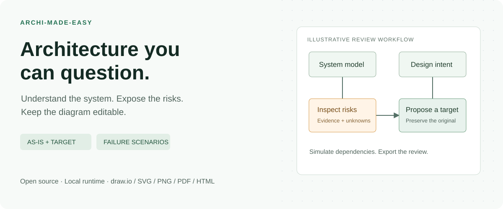

<div align="center">

# Archi-Made-Easy

### Draw the architecture. Question the design. See what breaks.

An open-source architecture skill and local CLI for turning system models into **editable diagrams, risk assessments, and failure scenarios**.

[](https://github.com/avinash7509/archi-made-easy/actions/workflows/ci.yml)
[](LICENSE)
[](package.json)

**[Download the full skill ZIP](https://github.com/avinash7509/archi-made-easy/releases/download/v0.1.4/archi-made-easy-0.1.4-full.zip)** · **[Try the live demo →](https://avinash7509.github.io/archi-made-easy/)** · [Quick start](#download-and-start) · [Roadmap](ROADMAP.md)



</div>

## Your diagram shows the happy path. What about the failure path?

You are reviewing a design. The database fails. Which capabilities disappear? Is the fallback really independent? Does the public API bypass its WAF? And can someone edit the diagram after the meeting?

Archi-Made-Easy connects those questions to one versioned architecture model. Your agent reads the evidence and reasons about the design; the local runtime checks declared facts, simulates dependencies, and produces the artifacts.

**Start with the [interactive demo](https://avinash7509.github.io/archi-made-easy/).** Turn on **Failure simulation**, click **Order database**, then switch between **as-is** and **target**. It uses synthetic data and requires no account, API key, or installation.

## What you get

| In the architecture review | In the output folder |
|---|---|
| An honest picture of the current system | Preserved as-is model and diagram with risk callouts |
| A proposed improvement, not an overwritten history | Separate target model, remediation diff, and residual findings |
| “What fails when this goes down?” | Structural blast-radius analysis with required, optional, fallback, and quorum dependencies |
| Security and reliability checks you can inspect | Six-pillar report with **pass / fail / unknown / not applicable**, plus evidence coverage |
| Artifacts the next architect can edit | Native **draw.io**, SVG, PNG, PDF, and standalone interactive HTML |
| Reasoning that travels with the diagram | Architecture dossier, assumptions, ADR starter, and scenario reports |

**Local execution. Apache-2.0. No paid diagramming service required.** After setup, rendering and bundled assessments work offline. Provider refreshes and optional icon acquisition need network access.

## Compact skill upload (Python hosts)

**[Download the compact skill ZIP](https://github.com/avinash7509/archi-made-easy/releases/download/v0.1.4/archi-made-easy-0.1.4-compact.zip)** for hosts where you upload only `SKILL.md`, `agents/`, `references/` and `scripts/`. It includes its own schema and MCP example; no manual trimming or Node installation is needed. Python execution and file attachments must be supported by the host.

The compact renderer produces multi-view interactive HTML, multi-page editable draw.io, SVG and CASG. It uses compact columns, explicit MCP/REST flow colors and whole-model failure inspection. It does not include the Node WAF/availability engine. [Start here](skills/archi-made-easy/references/compact-start.md) · [MCP demo](https://avinash7509.github.io/archi-made-easy/compact-mcp.html).

## Download and start

**[Download Archi-Made-Easy — complete v0.1.4 package](https://github.com/avinash7509/archi-made-easy/releases/download/v0.1.4/archi-made-easy-0.1.4-full.zip)**. One ZIP includes root `SKILL.md`, references, compiled runtime, pinned JavaScript dependencies, schemas, catalogs, source, examples, and an interactive demo. No Git clone or npm install is needed.

1. Extract the ZIP and read `START-HERE.md`.
2. With **Node.js 22+** installed, run `node setup.mjs`.
3. Ask your agent to read the extracted `SKILL.md` and describe the system you want to design or review.

For PNG/PDF, run `node setup.mjs --browser` once to download Chromium. Optional vendor icons also download separately. HTML/SVG/draw.io and analysis work offline after extraction with Node installed.

Python-only host? Run `python scripts/render_workbench.py runtime/examples/hybrid.json --out artifacts/python-demo`. This offline fallback creates HTML, SVG, draw.io and CASG; PNG is optional. It does not run the full Node policy/availability engines.

You can upload the ZIP to hosts accepting skill archives, subject to their limits. Full functionality requires filesystem access and Node.js execution; a Markdown-only or chat-only host cannot run the engine. Hosted-agent compatibility is not certified. This bundles the **implemented v0.1 features**, not every item in the [roadmap](ROADMAP.md). [Setup guide](scripts/bundle/START-HERE.md) · [Release and checksums](https://github.com/avinash7509/archi-made-easy/releases/tag/v0.1.4).

## Run it locally

Requires Node.js 22+. This is a source install; the package is not published to npm.

```sh
git clone https://github.com/avinash7509/archi-made-easy.git
cd archi-made-easy
npm ci
npm run build
npm run demo:quick
```

Open **`artifacts/demo/index.html`**. The quick demo generates HTML, SVG, editable draw.io, and analysis reports without downloading a browser.

For PNG and PDF exports:

```sh
npx playwright install chromium
npm run demo
```

Optional official service icons: `node dist/cli.js assets azure` (also `aws` or `gcp`). Icons remain in a local cache under their vendor terms; missing icons use labeled generic cards.

## Give your agent this prompt

```text
Use Archi-Made-Easy to review this repository.
Create an evidence-backed as-is architecture and a separate proposed target.
Show public entry points, stateful dependencies, and failure boundaries.
Simulate loss of the primary database. Preserve our MVP cost constraints.
Deliver editable draw.io and an interactive HTML review.
Label missing evidence rather than inventing deployed controls.
```

Use the [skill](skills/archi-made-easy/SKILL.md) directly from the checkout, or install a self-contained Codex skill:

```sh
node scripts/install-skill.mjs
```

The installer preserves existing installations. Other agents can read the same skill and invoke the local CLI; compatibility has not been benchmarked across every host. [More architecture-review prompts →](docs/prompts.md)

## A model you can version. A diagram you can revise.

```text
Requirements / repository evidence
                ↓ agent reasoning
Canonical Architecture Semantic Graph (CASG)
                ├── contextual assessment + evidence coverage
                ├── failure scenarios + explicit assumptions
                ├── preserved as-is → proposed target + diff
                └── measured views → draw.io / SVG / PNG / PDF / HTML
```

The [hybrid example](examples/hybrid.json) is a complete starting model. See the [CASG schema](schemas/casg.schema.json) and [CLI guide](docs/cli.md) for authoring and round-trip editing.

## Where it fits today

**v0.1 is an early, working foundation.** It is useful for evidence-led architecture conversations, editable deliverables, and explicit dependency scenarios. It is not a cloud compliance certification or a substitute for production testing.

- Rules inspect declared model facts; static discovery does not fully interpret every IaC expression or prove deployed configuration.
- Proposed controls are not verified implementations. Stateful replication and migration design still require architectural judgment.
- Availability and latency estimates carry assumptions. Browser rendering is not perceptual review.
- Provider catalogs are limited. Secondary UML/ERD views are generic, not full notation implementations.
- The default tradeoff matrix is illustrative; the agent must ground real decisions in your requirements.

[Full implementation status](docs/implementation-status.md) · [Confidence guidance](skills/archi-made-easy/references/analysis.md)

## Help make architecture reviews better

The most useful contribution is **a small, anonymized architecture that exposes a wrong conclusion or an unreadable diagram**.

- [Report an architecture trap](https://github.com/avinash7509/archi-made-easy/issues/new?template=architecture-trap.yml): expected behavior, actual finding, and a minimal model.
- [Report a rendering bug](https://github.com/avinash7509/archi-made-easy/issues/new?template=bug-report.yml): a model plus a screenshot beats a vague description.
- Add a source-backed provider rule, a valid counterexample, or an example another architect can reuse.

[Contribution guide](CONTRIBUTING.md) · [Public roadmap](ROADMAP.md) · [Discussions](https://github.com/avinash7509/archi-made-easy/discussions)

If this helps your next design review, **star the repository** or share a sanitized example of what you built. Useful real-world cases will shape what ships next.

## Evidence, not leaderboard claims

Run `npm test` and `npm run benchmark:fixtures` to reproduce the checks. The suite includes 30 deterministic fixture cases; that is **not** the planned cross-model benchmark. Blind comparisons against diagram-design and Archify have not been run. No superiority claim is made.

Inspired by lessons from [diagram-design](https://github.com/cathrynlavery/diagram-design), [Archify](https://github.com/tt-a1i/archify), and official cloud architecture guidance. Original implementation is Apache-2.0; see [NOTICE](NOTICE). Cloud trademarks and icons retain their respective terms.
